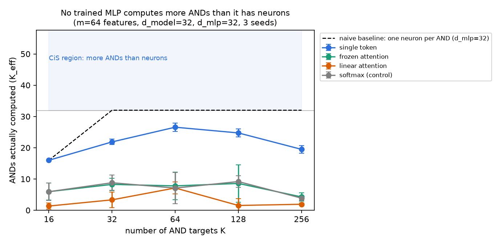
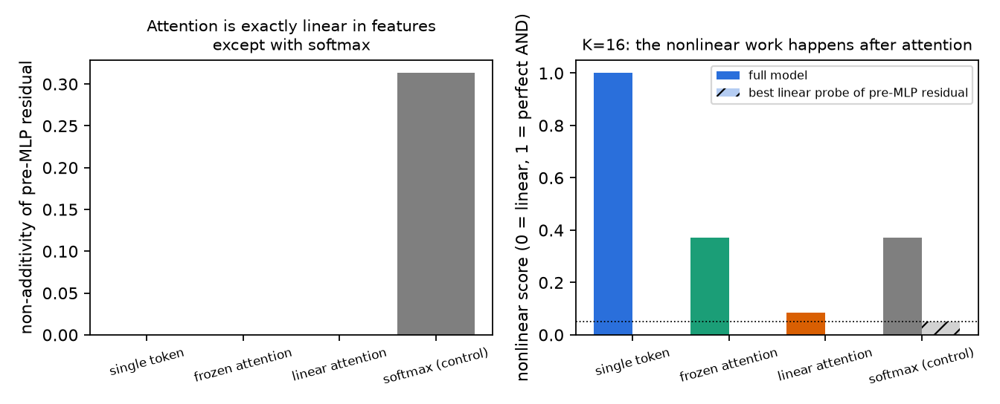

# 03. Constrained attention: does the MLP compute in superposition?

Stage one (`02-memorisation-and-logitlens/`) ended on a red-team result: in a 1-layer transformer, ablating the MLP left XOR accuracy above 99%, because softmax attention can do the nonlinear work itself. So you cannot look for MLP-level computation in superposition (CiS) without first taking the nonlinearity out of attention. This folder does that, then asks whether the MLP computes more nonlinear functions than it has neurons.

## Questions I want to answer

- If attention is forced to be linear, does the MLP become the only place the nonlinear work happens?
- In that setting, does a trained MLP compute more ANDs than it has neurons (CiS), or does it stop at about one AND per neuron?
- Does the answer change with the way attention is constrained, with the number of targets, or with scale?

## Setup

**Task.** There are m sparse boolean features x ∈ {0,1}^m, each on with probability p. The model must output K pairwise ANDs, y_k = x_a · x_b, through a **linear** readout trained with MSE. The pairs are fixed and random. The readout is linear on purpose: with a sigmoid or a threshold, the output nonlinearity could compute the AND itself.

**Model.** One attention layer, one ReLU MLP, linear unembed, read out at a single position. **No LayerNorm** anywhere, because LayerNorm is also a nonlinearity.

**Four ways the features reach the MLP:**

| Variant | How | Attention linear in x? |
|---|---|---|
| `single_token` | all features packed into one embedding vector (m=64 into d_model=32, so stored in superposition) | yes: attention over one token is a linear map |
| `frozen` | one token per active feature plus PAD, read at a CLS token whose attention pattern is fixed and uniform | yes |
| `linear` | same tokens, attention scores q·k with no softmax; the query comes from the fixed CLS token | yes: each score depends on one token only |
| `softmax` | same tokens, ordinary softmax attention | no (the control) |

Each run checks the "linear in x" column directly (`attention_additivity_gap`): for disjoint feature sets A and B, the test is resid(A+B) − resid(A) − resid(B) + resid(∅) = 0.

**Metric.** For each output k: NL_k = (R²_k − R²lin_k) / (1 − R²lin_k), where R²lin_k is the best linear fit from the true features. NL = 0 means no better than linear; NL = 1 means a perfect AND. K_eff = Σ_k clip(NL_k, 0, 1) is the number of ANDs actually computed.

**The four-criterion CiS test.** A run counts as CiS only if all four hold:

1. **C1, MLP necessary:** NL with the MLP mean-ablated is ≤ 0.05.
2. **C2, attention did no nonlinear work:** the best ridge probe on the pre-MLP residual has NL ≤ 0.05.
3. **C3, more functions than neurons:** K_eff > d_mlp. A naive solution that gives one neuron to each AND tops out at K_eff = d_mlp, so CiS has to beat that.
4. **C4, not a noise or seed artefact:** C3 holds on every seed, with noise-free labels. This is adapted from the *Compressed Computation is (probably) not CiS* critique, whose authors showed the earlier toy beat its naive baseline only because of noise mixed into its labels. Our labels are exact ANDs, so any advantage cannot come from label noise.

**Main sweep:** 4 variants × K ∈ {16, 32, 64, 128, 256} × 3 seeds, with m=64, p=0.06, d_model=32, d_mlp=32, 15k steps, AdamW, lr 3e-3. That is 60 runs, about 8 minutes on a laptop CPU.

## Results





Means over 3 seeds:

| Variant | K | NL (full) | NL (MLP ablated) | NL (pre-MLP probe) | K_eff / d_mlp=32 | live neurons | additivity gap |
|---|---|---|---|---|---|---|---|
| single_token | 16 | 1.000 | −7.8 | 0.000 | 16.0 | 29 | 0.000 |
| single_token | 64 | 0.395 | −19.6 | −0.023 | **26.6 ± 1.3** | 29 | 0.000 |
| single_token | 256 | 0.054 | −3.8 | −0.041 | 19.5 ± 1.2 | 26 | 0.000 |
| frozen | 16 | 0.372 | −6.3 | 0.000 | 5.9 ± 2.7 | 11 | 0.000 |
| frozen | 128 | 0.039 | −4.5 | −0.030 | 8.6 ± 6.0 | 17 | 0.000 |
| linear | 16 | 0.084 | −1.1 | 0.000 | 1.3 ± 0.9 | 7 | 0.000 |
| linear | 64 | 0.095 | −5.1 | −0.016 | 7.1 ± 1.9 | 17 | 0.000 |
| softmax | 16 | 0.371 | −3.4 | 0.050 | 5.9 ± 2.8 | 15 | 0.227 |
| softmax | 128 | 0.047 | −2.5 | −0.019 | 9.2 ± 1.9 | 19 | 0.310 |

The full table for every K is in `runs/main_lr=0.003_steps=15000/` (one JSON per run).

**R1. The constraint works and can be checked.** For `single_token`, `frozen` and `linear`, the pre-MLP residual is exactly additive in the features (gap 0.000 at float precision). For softmax the gap is 0.21–0.50. **C1 and C2 pass in every constrained run**: the probe on the pre-MLP residual never beats the best linear fit, and mean-ablating the MLP is far worse than linear. The nonlinear work is in the MLP, as intended.

**R2. No run passes C3. A trained MLP computes fewer ANDs than it has neurons.** The best result is `single_token` at K=64, with K_eff = 26.6 ± 1.3 against d_mlp = 32. K_eff peaks when K is about 2× d_mlp, then falls as K grows (19.5 at K=256), because more targets mean more interference. This is not undertraining: 40k steps give the same plateau (26.9 at K=64, 25.2 at K=128).

**R3. A simple hand-built CiS circuit is worse than the trained model.** `construct.py` builds the obvious superposed circuit: each neuron reads the features of several target pairs with bias −1, so it fires when two or more of them are on, and an optimal linear readout sits on top. At the main setting (p=0.06) it gets K_eff = 10.8 at K=64 and 5.4 at K=128, far below both the trained model and d_mlp. The reason is clear on paper. A neuron that reads {a, b, c, d} for targets (a, b) and (c, d) also fires for the 4 cross pairs. With independent features, those cross pairs are on exactly as often as the targets, so the readout cannot tell them apart. Making CiS work needs a smarter design (many overlapping neurons per pair, as in Hänni et al.) and more sparsity or width than this scale gives.

**R4. Larger scale gives a lead, not a result.** With m=256, d_model=64, d_mlp=64, p=0.02 and 3 seeds:
- **K=64:** K_eff = 36.6–39.8, still below d_mlp = 64, so C3 still fails.
- **But** only 30–35 neurons are alive, so the model computes about 1.1–1.2 ANDs per **live** neuron, on all 3 seeds.
- **K=128:** the ratio is 0.96–1.17.

This is the only place where any model does better than one AND per neuron it actually uses. It is not the pre-registered criterion, and the partial-credit K_eff could flatter it. It is a lead for the next stage, not evidence of CiS.

## Red-team: what could be wrong

- **The softmax control did *not* reproduce the stage-one confound.** Reading at a CLS token, softmax attention did only a little nonlinear work (probe NL ≤ 0.05; C2 failed on 1 of 3 seeds at K=16 and at K=32). Stage one read out at a content token (so the query depended on key_b, making q·k bilinear across features) and had LayerNorm. Those are the likely sources of its attention's nonlinear power. Likewise, "linear attention" is only linear in the features here because the query comes from a fixed token; with a content query it is bilinear and could compute pairwise ANDs itself. An ablation that adds those ingredients back one at a time is needed to pin this down.
- **The token variants are mostly an optimisation failure, not a capacity limit.** `frozen` and `linear` compute the same class of pre-MLP functions as `single_token` (affine in x), yet they end up with 4–18 live neurons out of 32, against 26–30. Their low K_eff is dead ReLUs. A higher learning rate and 40k steps help a little (frozen K=64: K_eff 7.8 → 15.4) but don't fix it. So the honest comparison for C3 is `single_token`.
- **K_eff gives partial credit.** Summing clipped NL over outputs counts ten half-computed ANDs as five. That is generous to the model, and C3 still fails.
- **One task family.** Independent features and random pairwise ANDs are the hardest case for interference. Correlated features, structured pairs or other targets might behave differently.
- **Small scale.** The theory (Hänni et al.) is asymptotic, and m=64 or 256 is tiny. R4 hints that scale matters.

## What I've come away with

- Constraining attention gives a clean instrument. You can **verify** that attention is linear (additivity gap = 0) and that the MLP is the only nonlinear component (C1, C2). Stage one couldn't do that.
- In this regime, gradient descent finds "about one AND per neuron, minus interference". It does not find computation in superposition. Here, the honest answer to "do trained networks compute in superposition?" is **not at this scale, on this task**. That is the "feature tools are on safe ground" branch from my original proposal, for now.
- The interesting open question is the gap between theory (CiS is possible and efficient) and training (it isn't found here). The things to test next are scale, sparsity, feature correlations, fixing dead neurons, and initialising at a good construction to see whether gradient descent keeps it.

## Files

- `cis_constrained.py`: task, the four model variants, training, and the four-criterion evaluation (one run per call).
- `sweep.py`: parallel grids (`regime`, `main`).
- `construct.py`: the hand-built superposed AND circuit.
- `make_figures.py`: the two figures.
- `runs/`: every run as JSON (config, curves, all metrics, per-output NL).

Reproduce (CPU, about 10 minutes):

```bash
python sweep.py main --workers 8 --set lr=0.003 steps=15000
python construct.py
python make_figures.py
```

## Reading

- Hänni et al., *Mathematical Models of Computation in Superposition* (arXiv 2408.05451). U-AND construction.
- Bhagat, Molas Medina, Giglemiani, Heimersheim, *Compressed Computation is (probably) not Computation in Superposition* (LessWrong, 2025). Baseline comparison and noise-dependence test, adapted here as C4.
